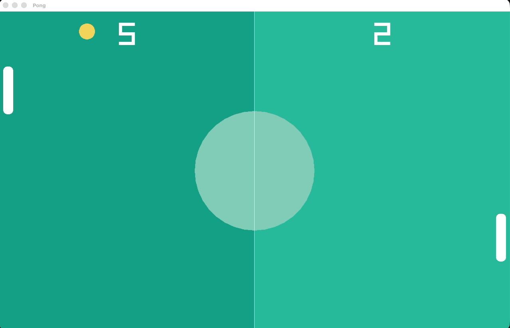

# Pong

A simple two-paddle Pong game built with C++ and [raylib](https://www.raylib.com/).



## How to play

- Use the **Up** and **Down** arrow keys to move the right paddle.
- The left paddle is controlled by the computer.
- Score by getting the ball past the computer paddle.
- Close the game window to quit.

## Run on Windows

1. Install Visual Studio with the **Desktop development with C++** workload.
2. Install [vcpkg](https://github.com/microsoft/vcpkg), then install raylib:

   ```powershell
   vcpkg install raylib:x64-windows --head
   vcpkg integrate install
   ```

3. Open `Pong.slnx` in Visual Studio.
4. Select the **x64** platform and **Debug** or **Release** configuration.
5. Build and run the project with **Ctrl+F5**.

The build copies `Pong/resources` next to the executable so the paddle sound can load correctly.

## Run on macOS

Install the command-line tools, Homebrew, and raylib:

```bash
xcode-select --install
brew install raylib
```

From the repository root, compile and run:

```bash
mkdir -p build/resources
clang++ -std=c++20 Pong/src/Main.cpp \
  -I"$(brew --prefix raylib)/include" \
  -L"$(brew --prefix raylib)/lib" \
  -lraylib \
  -framework OpenGL -framework Cocoa -framework IOKit \
  -framework CoreVideo -framework CoreAudio \
  -framework Metal -framework QuartzCore \
  -o build/pong
cp Pong/resources/paddleBounce.mp3 build/resources/
./build/pong
```

## Project layout

- `Pong/src/Main.cpp` — game source code
- `Pong/resources/paddleBounce.mp3` — paddle collision sound
- `Pong.slnx` — Visual Studio solution
